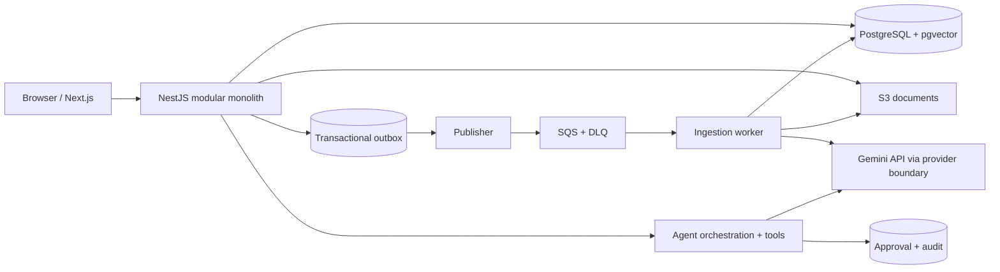

# Target architecture (planned, not yet implemented)

## Boundaries
- **Web** renders state; cannot enforce security by itself.
- **API** owns auth, workspace membership, business state, agent tool permissions and approval reauthorization.
- **Worker** processes at-least-once messages using deduplication/version constraints; never assumes exactly-once delivery.
- **Database** holds structured state and workspace-tagged embeddings. Outbox rows are committed atomically with business events.
- **Model provider** is reached from server-side components through a deliberately small adapter (`generate`, `embed`, `stream` only where justified). Agent orchestration is separate from the model adapter.

## Ingestion state machine
`PENDING_UPLOAD → UPLOADED → QUEUED → PROCESSING → READY / FAILED`.

Reuploads create a new document version; retries are safe. Use failure categories for retryable provider errors vs permanently invalid formats.

## Agent action state machine
`PROPOSED → PENDING_APPROVAL → APPROVED / DENIED / EXPIRED → EXECUTED / FAILED`.

An approval binds exact action arguments hash, user, workspace, deadline and idempotency key. Execution must recheck membership and action eligibility. Race tests are mandatory.

## Security / reliability
- Workspace identity comes from verified auth context + membership lookup, never arbitrary request body.
- S3 keys and DB queries segregate workspace content; presigned URLs expire.
- System prompts and retrieved text are distinct trust domains; contracts can be hostile.
- No model-generated SQL execution; only reviewed typed tools can change state.
- Token and tool limits protect user and system from excessive costs.

## Observability
Propagate trace IDs through HTTP request, outbox publication and worker processing. Never put document content or secrets in logs. Instrument queue depth, latency, errors, tool outcomes and token spend.

## Stack note
We intentionally avoid Kubernetes and microservices until actual operational requirements justify them. AWS ECS/RDS/SQS will be considered at deployment milestone, not provisioned automatically.
